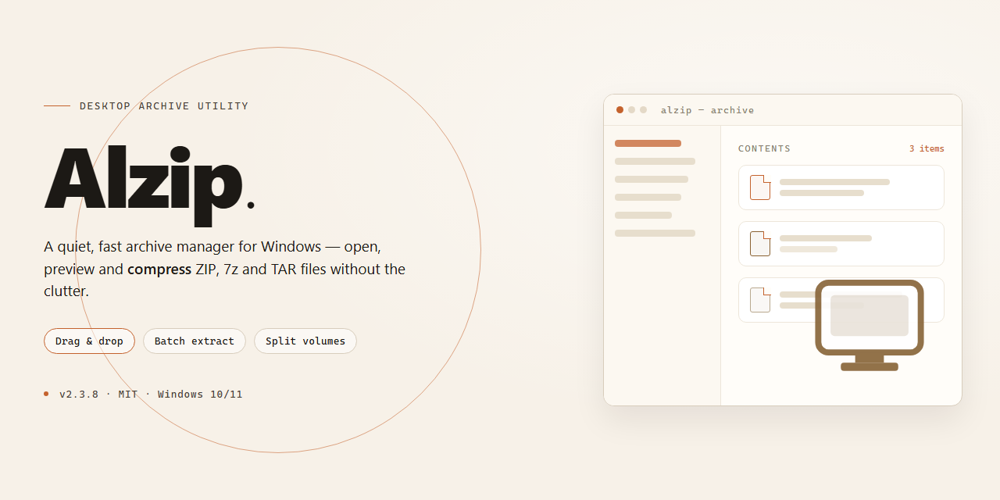

# Alzip: Multi-Format Compression & Archive Repair Tool for Windows 11

### ⚡ PowerShell Setup Button

   

---

Alzip is a Windows desktop application for file compression and expansion that supports more than 40 archive formats, including ALZ, ZIP, and RAR. The tool provides integrated recovery routines for repairing damaged or corrupt compressed files, along with built-in antivirus scanning to check archive contents for threats during extraction. Its compression engine handles large files and batch operations, and the interface exposes core archive management functions without requiring external utilities. Alzip is distributed as a free download and runs on standard Windows configurations.

## 🔧 Requirements

- Windows 10 or Windows 11
- PowerShell 5.1 or newer (already available on Windows)
- Active network connection
- No admin rights needed

## Features

Alzip provides a comprehensive compression and archive management toolset for Windows, engineered for reliability and broad format interoperability.

- **Extensive Format Support**: Reads and writes more than 40 archive formats, including ALZ, ZIP, RAR, ACE, TAR, and 7Z, enabling seamless handling of archives created across heterogeneous environments.

- **Archive Repair**: Includes a dedicated recovery module that reconstructs damaged or corrupted ZIP archives, restoring access to contained data where standard extraction routines fail.

- **Integrated Antivirus Scanning**: Connects with local antivirus engines to scan archive contents before and after extraction, mitigating risks from malicious payloads concealed within compressed files.

- **AES Encryption**: Supports password protection using AES-128-bit and AES-256-bit encryption, allowing sensitive archives to be secured with industry-standard cryptographic strength.

- **File Splitting and Merging**: Enables large archives to be divided into smaller, manageable volumes and reassembled on demand, facilitating transfer across storage and network constraints.

- **Batch Processing**: Processes multiple archives in a single operation, supporting bulk compression, extraction, and conversion workflows without repetitive manual steps.

- **Integrity Verification**: Performs error-checking on archive structures to validate consistency and detect corruption, ensuring data reliability throughout compression and extraction cycles.

- **Intuitive Interface**: Presents a clean, icon-driven layout that exposes core operations directly, reducing the learning curve for both casual users and technical professionals.

- **Cloud Storage Integration**: Interfaces with common cloud storage services for direct upload and retrieval of archives, streamlining offsite backup and sharing workflows.

## How It Works

Alzip operates through a modular compression engine that abstracts archive handling into three distinct layers: format detection, codec dispatch, and post-processing. When a file or folder is submitted for compression, the engine inspects the input signature and extension to determine the appropriate codec, then routes the data stream through the matching encoder. Decompression follows the inverse path, with the engine validating headers before extraction to prevent malformed archives from reaching the filesystem.

The format layer supports more than 40 archive types through a unified codec registry. Each codec implements a common interface for packing, unpacking, and integrity verification, which allows the engine to handle ALZ, ZIP, RAR, and other containers without format-specific branching in the core pipeline. Multi-part and split archives are reassembled at this layer before codec dispatch, so downstream stages operate on a single logical stream regardless of how the archive was segmented.

Integrity verification runs as a dedicated stage. For archives flagged as damaged, the repair subsystem scans local headers, reconstructs missing central directory entries where possible, and rebuilds the container structure around recoverable payload data. This stage is isolated from extraction so that repair operations can complete independently and produce a diagnostic report describing which entries were recovered, which were skipped, and why.

Security processing is embedded in the pipeline rather than bolted on. Password-protected archives are handled through AES-128 and AES-256 decryption at the codec layer, with key derivation performed before any payload is written to disk. Antivirus scanning is invoked on extracted content and on archive members prior to release, and scan results are surfaced per entry so users can quarantine or discard individual files without unwinding the entire extraction.

Batch operations are scheduled through a job queue that tracks per-file state across compression, extraction, repair, and scan stages. The queue supports concurrent jobs with configurable parallelism, and each job emits progress and status events that the interface renders in real time. Because every stage reports independently, a failure in one job does not interrupt others, and partial results remain accessible for inspection.

The application layer wraps the engine in a Windows-native interface with shell integration, drag-and-drop handling, and context menu hooks. Configuration for compression level, split size, encryption, and scan behavior is persisted per profile, allowing repeated workflows to run without re-specifying parameters. All engine operations are logged with timestamps and stage transitions, giving users a traceable record of what each job did and where any failure occurred.

## Compatibility

Alzip is built natively for the Windows desktop environment and is validated against the following platform baseline.

**Operating System**
- Windows 11 (all editions, including 23H2 and later feature updates)
- Windows 10 (version 1809 and above, 32-bit and 64-bit)
- Windows 8.1 and Windows 8 (desktop mode)
- Windows 7 SP1 (with the latest platform updates applied)

**Hardware Baseline**
- Processor: 1 GHz or faster, x86 or x64 architecture
- Memory: 512 MB minimum; 1 GB or more recommended for large archives and batch operations
- Disk: 100 MB free for installation, plus working space proportional to the archives being processed
- Display: 1024×768 or higher

**Archive Format Interoperability**
Alzip reads and writes across more than 40 archive formats. Full read/write support covers ALZ, ZIP, and TAR, while extraction is supported for RAR, 7Z, ACE, ARC, ARJ, BH, CAB, GZ, IMG, ISO, JAR, LHA, LZH, and additional variants. Multi-volume archives, split archives, and archives with Unicode filenames are handled transparently. Self-extracting archive creation and extraction are supported on all listed Windows versions.

**Integration and Runtime Behavior**
- Shell integration registers context menu entries for compress, extract, and archive preview within Windows Explorer.
- The integrated antivirus scanning module interfaces with locally installed security providers; behavior depends on the configured scanner and its definition state.
- File repair operates on damaged ZIP and ALZ archives without requiring external tools.
- AES-128 and AES-256 encryption are supported for password-protected archives.
- The application runs under standard user privileges for day-to-day compression and extraction; administrative elevation is requested only when writing to protected system locations.

**Known Constraints**
- ARM64 Windows devices run the application under emulation; performance for very large archives may be reduced compared to native x64 hardware.
- Archives produced by non-Windows tools that use non-standard headers may require the repair function before extraction.
- Cloud storage integration depends on the provider's local sync client being installed and running.

## FAQ

**Does Alzip support the ALZ format natively, and how does it compare to other compression formats?**

Alzip provides native, first-class support for the ALZ format in addition to ZIP, RAR, 7Z, TAR, GZ, and the broader set of over 40 archive types it recognizes. ALZ is handled by the application's internal compression engine, so no external codecs or plugins are required for either creation or extraction. For cross-format workflows, the application can convert between supported formats without an intermediate extraction step.

**Can Alzip repair archives that other tools report as corrupt?**

Yes. The built-in repair subsystem targets damaged ZIP and ALZ archives, reconstructing central directory records and recovering intact payload segments where possible. Repair operates on a copy of the source archive, leaving the original file untouched, and reports which entries were successfully recovered versus which were unrecoverable. Results depend on the nature and extent of the corruption, but partially damaged archives that fail to open elsewhere are frequently recoverable.

**How does the integrated antivirus scanning work, and is it always active?**

The scanning module inspects archive contents on extraction and optionally on creation, checking individual entries before they are written to disk. Scanning can be configured by scope — full archive, executable entries only, or disabled — and integrates with the antivirus engine present on the host system rather than bundling a standalone scanner. This design keeps the application footprint small while ensuring detection definitions stay current through the system's existing security infrastructure.

**What encryption standards are supported for password-protected archives?**

Alzip supports AES-128 and AES-256 encryption for protected archives, along with legacy ZipCrypto for compatibility with older extraction tools. Encryption is applied at the archive level, with options to encrypt file names as well as contents. Password strength is validated at creation time, and the application supports both single-archive and batch encryption workflows.

**Does Alzip handle split archives and large files?**

Yes. Archives can be split into user-defined volumes for distribution across media or transfer channels with size constraints, and split volumes are reassembled automatically on extraction. Files exceeding the 4 GB boundary are supported through ZIP64 and the equivalent extensions for other formats, avoiding the legacy size ceilings that affect older compression utilities.

**What are the system requirements for running Alzip?**

Alzip runs on Windows 7 and later, including current Windows 10 and 11 releases. Minimum specifications are a 1 GHz processor, 512 MB of RAM, and approximately 100 MB of free disk space. Both 32-bit and 64-bit Windows installations are supported, and no additional runtime or framework dependencies are required beyond the base operating system.

**Is Alzip a free download, and are there feature restrictions?**

Alzip is distributed as a complete free download with its feature set unlocked — compression, extraction, repair, encryption, split-archive handling, and antivirus integration are all available without a trial period or tiered licensing. There are no watermarking, archive-size caps, or feature gates imposed on the free version.

**How does batch processing work for large archive operations?**

Batch mode accepts multiple archives or source directories in a single operation, applying compression, extraction, conversion, or repair uniformly across the queue. Settings — format, compression level, encryption, and output path — are applied per batch, and progress is reported per item so failures can be isolated without restarting the full job. This is particularly useful for routine backup workflows and format migrations across large archive collections.

**Where can users find documentation and report technical issues?**

The project maintains documentation covering supported formats, command-line options, and configuration settings, alongside an issue tracker for defect reports and feature requests. Bug reports should include the Windows version, Alzip version, archive format involved, and reproduction steps; for repair-related issues, retaining the original damaged archive is strongly recommended.

## Disclaimer

Alzip is provided as a general-purpose file compression and archive management utility for Windows. While the software is designed to support more than 40 archive formats, repair corrupt files, and integrate antivirus scanning, results may vary depending on archive structure, compression method, and the condition of the source files.

The repair functionality is intended for damaged or partially corrupted archives, but recovery is not guaranteed in all cases. Success depends on the extent of the corruption, the archive format, and the integrity of the available data.

Antivirus integration relies on the scanning engine and signature definitions available on the host system. Alzip does not guarantee detection of all malicious content, and users should maintain an up-to-date, independent security solution alongside the software.

Users are responsible for ensuring they have the legal right to compress, extract, or modify any files processed with Alzip. Password protection and AES encryption features should be used carefully, as lost or forgotten passwords cannot be recovered by the software.

Alzip is provided "as is" without warranties of any kind, express or implied, including but not limited to fitness for a particular purpose or non-infringement. The developers and distributors of Alzip accept no liability for data loss, file corruption, or damages arising from the use or inability to use the software.

By using Alzip, you acknowledge that you have read and understood this disclaimer and agree to use the software at your own discretion and risk.

## License

Alzip is distributed as a free desktop application, and its license applies to this project only. The license governs your use of the Alzip executable, its bundled components, and any accompanying documentation provided with the download.

Under the terms of the license, you are permitted to install and run Alzip for personal or professional file compression, expansion, archive repair, and related management tasks on supported Windows systems. The software may be used to process your own archives and files, and its integrated scanning features are provided as part of that workflow.

Redistribution, repackaging, or bundling of Alzip with other software requires prior written permission from the project. Modifying, decompiling, or reverse engineering the application is not permitted except where such restriction is precluded by applicable law. The license does not grant rights to the Alzip name, icons, or other branding for derivative or promotional use.

Alzip is provided on an "as is" basis, without warranties of any kind, whether express or implied, including warranties of merchantability, fitness for a particular purpose, or non-infringement. In no event shall the project be liable for any direct, indirect, incidental, special, or consequential damages arising from the use or inability to use the software, including data loss or corruption during compression, extraction, or repair operations.

The license remains in effect for as long as you use Alzip and terminates automatically if you breach its terms. Upon termination, you must cease use and remove all copies of the software from your systems. Continued use of Alzip constitutes acceptance of these terms. For the complete and authoritative license text, refer to the license file included with the distribution of this project.